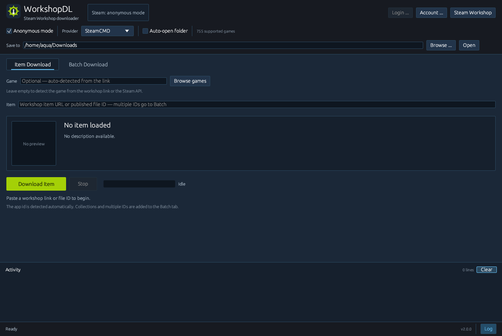

# WorkshopDL for Linux

A native Steam Workshop downloader for Linux, written entirely in Rust with
[eframe](https://github.com/emilk/eframe) and
[egui](https://github.com/emilk/egui). No Python, Electron, or embedded browser
is required.




## Features

- Download a single Workshop item, or queue a batch.
- Paste a collection URL to expand its items into the batch queue.
- Accepts Workshop URLs or bare published-file IDs. Multiple IDs are sent to
  the Batch tab automatically.
- Detects Workshop links from the clipboard and fills in the item field.
- Shows item previews, including animated GIFs, and Workshop descriptions.
- Downloads through SteamCMD or GGNetwork.
- Steam sign-in with Steam Guard prompts, or account-free anonymous mode.
- Queue import/export, reordering, cancellation, and finished-row cleanup.
- Native folder picker, persistent settings, auto-open output folder, and an
  optional finish sound.
- Steam Workshop dark theme, remembered window size, and a desktop/taskbar icon.

## Requirements

- Linux desktop running Wayland or X11.
- Rust 1.88 or newer with Cargo. Install it from [rustup.rs](https://rustup.rs/)
  if necessary.
- GTK 3 development headers and `pkg-config` for the native folder picker.
- OpenGL drivers, plus the usual X11/Wayland development packages on minimal
  systems.
- `tar` for the first-time SteamCMD installation.
- `curl`, used first for Steam Community page requests.
- `xdg-open` for the "Open" and "Steam Workshop" buttons.

Optional: install `ffplay`, `mpv`, `paplay`, `pw-play`, or `aplay` to play the
finish sound. Without one of these, the app falls back to a terminal bell.

### Build dependencies

```bash
# Arch / CachyOS
sudo pacman -S --needed base-devel pkgconf gtk3 curl tar

# Debian / Ubuntu
sudo apt install build-essential pkg-config libgtk-3-dev curl tar
```

On a minimal installation, also install your distribution's X11/Wayland and
OpenGL development packages.

## Build and run

```bash
git clone <repository-url>
cd Workshop-DL-Linux
cargo build --release
./Project/run.sh
```

`Project/run.sh` sets `WORKSHOPDL_PROJECT_DIR` and launches
`target/release/workshopdl-linux`. Set `WORKSHOPDL_REBUILD=1` to rebuild before
launching. Running the binary directly from the repository root also works:

```bash
./target/release/workshopdl-linux
```

On the first SteamCMD download, the app fetches Valve's SteamCMD into
`Project/steamcmd/` automatically.

## Usage

1. Paste a Workshop item URL or published-file ID into **Item**.
2. Choose **SteamCMD** or **GGNetwork** and an account mode.
3. Press **Download Item**. The app resolves the app id, title, description,
   and preview, then starts the download.
4. For a queue, paste several URLs/IDs or open a collection URL. The items are
   added to the **Batch Download** tab, where they can be reordered, imported,
   exported, or cancelled before pressing **Start Download**.
5. Change the account, provider, and output folder under **Account & Settings**.

Downloaded items are written to:

```text
Project/downloads/<appid>/<fileid>/
```

## Providers

| Provider | Steam login | Notes |
| --- | --- | --- |
| **SteamCMD** | Required for most paid games; anonymous mode works for some public items | Valve's official client. The most reliable option when the account owns the game. |
| **GGNetwork** | Not required | Third-party fallback. Availability and speed depend on the GGNetwork service and its mirrors. |

Anonymous mode only downloads items that are publicly accessible. If SteamCMD
reports **Access Denied** or a download failure, use an account that owns the
game or try GGNetwork.

Steam passwords are passed directly to SteamCMD and are not written to the
settings file. The saved settings contain only the username, anonymous mode,
provider, output folder, auto-open preference, and window size.

## Configuration and data

| Path | Purpose |
| --- | --- |
| `Project/config/settings.json` | Account name, anonymous mode, provider, output folder, auto-open, window size |
| `Project/downloads/` | Downloaded items, grouped by app id and file id |
| `Project/steamcmd/` | SteamCMD installation and staging area |
| `Project/sounds/finish.mp3` | Optional download-finished sound |
| `assets/games.json` | Bundled game database used for app-id detection |

`Project/config/`, `Project/downloads/`, and `Project/steamcmd/` are ignored by
Git. They are created on demand.

## Project layout

```text
src/
  main.rs          eframe entry point
  app.rs           UI, state, queue, and download coordination
  steamcmd.rs      SteamCMD process, login, and download engine
  ggntw.rs         GGNetwork provider
  workshop_api.rs  Steam API calls, page parsing, and descriptions
  games.rs         Bundled game database
  settings.rs      Settings persistence
  desktop.rs       Desktop entry and icon integration
  jobs.rs          Shared job and result types
  util.rs          Paths, processes, formatting, and sound playback
assets/             Icons and game database
docs/               README screenshot
Project/            Runtime data, launcher, and finish sound
```

## Tests

```bash
cargo fmt --check
cargo test
```

The normal suite covers description parsing and SteamCMD prompt/login handling.
Live network tests are ignored by default because they contact Steam and may
download items:

```bash
cargo test --release live_descriptions -- --ignored --nocapture
cargo test --release resolves_live_item_with_description -- --ignored --nocapture
cargo test --release downloads_public_item -- --ignored --nocapture
cargo test --release live_login_falls_back -- --ignored --nocapture
```

## Troubleshooting

- **SteamCMD download fails:** check the network connection, make sure `tar` is
  installed, and confirm the app can write to `Project/steamcmd/`.
- **Access Denied or item download failure:** the account may not own the game,
  or the item may not allow anonymous access. Sign in with an owning account or
  use GGNetwork.
- **GGNetwork fails:** the third-party service may be unavailable. Switch back
  to SteamCMD.
- **Folder picker does not open:** install the GTK 3 runtime/development
  packages for your distribution.
- **No finish sound:** install one of the optional audio players listed above.
- **Description is empty:** some Workshop items genuinely have no description.

## License

MIT. See the package metadata in [Cargo.toml](Cargo.toml).

Steam and Steam Workshop are trademarks of Valve Corporation. This project is
not affiliated with Valve.
